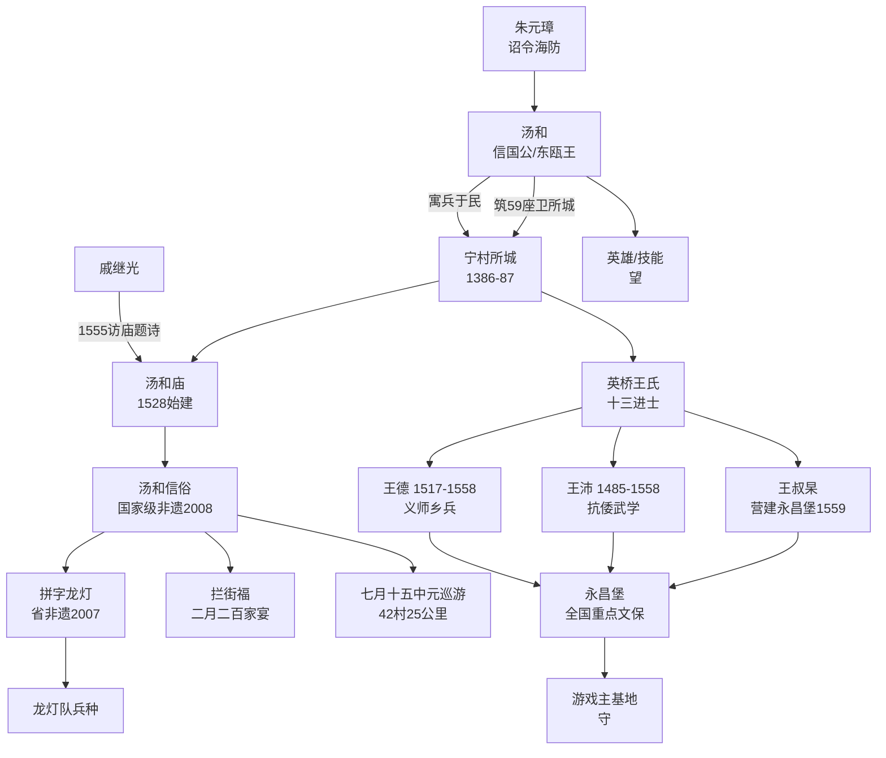

# 汤和信俗 · 永昌堡文化资料 —— AI 理解索引与知识图谱

> 专项关系索引：`docs/06-资料文本化/堡与汤和关系索引.md`（含语料统计、直接/间接关系分级、时间线、Mermaid 关系图与游戏内展示方案）。

> 用途：把 `docs/01-参考资料包/` 的非结构化资料（PDF/DOCX/图片）文本化、结构化，供 AI 与游戏设计直接检索。
> 生成时间：2026-11-22 ｜ 主题关联：2026 OSGJ 主题「守·望」、文化传承创新奖
> 配套产物：`文档文本/`（全文）、`图片OCR/`（逐图 OCR）、`缩略图/`、`联系表/`、`image_index.json`（图片元数据）

---

## 1. 资料清单（已文本化）

| # | 原文文件 | 文本化产物 | 规模 | 内容 |
|---|---|---|---|---|
| 1 | 永昌堡参考资料-yongchang-fort.pdf | `文档文本/永昌堡-十三进士与抗倭纪略-全文.txt` | 552页 / 109.8万字节 | 《永昌堡十三进士与抗倭纪略》全书：上篇人物志12章、中篇抗倭志2章、下篇城堡志2章、附录年谱+参考文献 |
| 2 | 意绘汤和漫画-彩版-1122(3).pdf（素材包内） | `文档文本/意绘抗倭英雄汤和-漫画全文.txt` | 101页 / 3.6万字节 | 漫画《意绘抗倭英雄汤和》，张毅编绘，讲汤和抗倭生平 |
| 3 | 抵御倭患第一人+汤和.docx | `文档文本/…抵御倭患第一人+汤和(1)(1).txt` | 4146字 | 汤和生平、宁村所城、汤和庙、汤和信俗、拦街福、拼字龙灯、书法村 七篇短文 |
| 4 | 龙湾汤和信俗文化节启幕…docx | `文档文本/…拼字龙灯邀您共同祈愿…txt` | 806字 | 汤和诞辰700周年文化节，拼字龙灯五龙同舞、158人、25.5米 |
| 5 | 汤和庙基地介绍.doc | `文档文本/…汤和庙基地介绍.txt` | 2088字 | 汤和庙建筑形制、碑文、张璁/戚继光题诗、巡游42村25公里 |
| 6 | 修改稿.docx | `文档文本/…修改稿.txt` | 82字 | 折页排版备注（红龙蓝龙位置互换），非正文 |
| 7 | 汤和信俗素材包（56项） | `图片OCR/`、`缩略图/`、`联系表/`、`image_index.json` | 44图 + 上述文档 | 拼字龙灯五龙、698周年巡游、民间信俗、拦街福、汤和像等 |

---

## 2. 文化实体图谱

### 2.1 人物谱（人物 → 身份 → 事迹 → 游戏可用设定）

| 人物 | 生卒/朝代 | 身份 | 关键事迹 | 游戏化钩子 |
|---|---|---|---|---|
| **汤和** | 1326–1395，明开国名将 | 信国公，追封东瓯王，谥襄武 | 朱元璋旧友；三赴沿海，筑卫所59座；推行"寓兵于民"；名言"成远算者不恤近怨" | 英雄单位/主城守护神；技能"筑城""寓兵于民" |
| **王叔杲** | 明，英桥王氏 | 进士、经世干臣 | 主持营建永昌堡（1559落成） | 建筑主线角色；"筑城"科技树 |
| **王叔果** | 明，英桥王氏 | 进士、半山气象、乡贤 | 文脉奠基 | 书院/文化建筑解锁 |
| **王沛** | 1485–1558 | 抗倭武学、"仁山垂光" | 从"益府良医"到抗倭烈士 | 武学/防御型英雄 |
| **王德** | 1517–1558，嘉靖十七年进士 | "文心武胆" | 缔造义师、永嘉场乡兵，抗倭英烈 | 暴兵系统"乡勇/义师"来源 |
| **王激** | 明 | "心学先驱" | 学术传承与事功 | 学者/增益单位 |
| **王诤** | 明 | "铁面冰心" | 监察生涯、刚直精神 | 监察/反腐事件卡 |
| **王良心、王继明、王名世、王光经、王维夔、王锡琯、王玉、王壬** | 明清 | 十三进士其余成员 | 道德坚守、法治、武学、清廉、仕隐、编纂《王氏续录》 | 进士单位群像/图鉴 |
| **戚继光** | 1528–1587 | 抗倭名将 | 1555年访宁村汤和庙，题七言律诗 | 客将/联动单位 |
| **张璁** | 1475–1539，明首辅 | 内阁首辅 | 汤和庙落成赋诗；拼字龙灯起源传说之一 | 文化事件卡 |
| **朱元璋** | 明太祖 | 开国皇帝 | 诏令汤和筹划海防 | 剧情引子 |

### 2.2 地点谱

| 地点 | 属性 | 关键数据 | 游戏化钩子 |
|---|---|---|---|
| **永昌堡** | 明代军民两用古堡，全国重点文保 | 嘉靖三十八年（1559）落成；瓯江口南岸、大罗山东麓；明清出十三进士 | 主基地/城防关卡；"守"的核心场景 |
| **宁村（宁村所）** | 明代卫所城，"中华姓氏第一村" | 洪武19–20年（1386–87）建；汤和59城之一；周长600丈、四门+水门、护城河；明初驻兵1175名；现存92姓 | 卫所关卡/多姓部落联盟设定 |
| **汤和庙** | 国家级非遗"汤和信俗"核心载体，浙江文保 | 始建明嘉靖七年（1528）；占地约1150㎡；四进三院；中轴照壁/台门/前厅/古戏台/拜亭/正殿/后殿 | 信仰建筑；产"香火"资源 |
| **抗倭英烈陵园** | 爱国主义教育基地 | 约4亩；安葬战死官兵；龙湾抗倭文化纪念馆（沙盘/实物/米塑/智能灯光/立体翻书） | 纪念建筑/文化事件 |
| **七星河、三十六古井、十字古街** | 宁村古迹 | 七星河呈北斗七星布局；十字街各长635米 | 地图地形/资源点 |
| **温州龙湾** | 地域 | 瓯江入海口南岸；汤和信俗、拼字龙灯之乡 | 关卡地理背景 |

### 2.3 事件与民俗谱

| 名称 | 类型 | 时间/层级 | 关键内容 | 游戏化钩子 |
|---|---|---|---|---|
| **汤和信俗** | 国家级非遗（2008） | 春秋两祭，400+年 | 春祭正月初九（安徽戍卒后裔思祖）；秋祭七月十五中元（祭抗倭先烈、安抚亡魂）；"城隍出巡""追悼倭难亡魂"；巡游42村、25公里、2000+人 | 核心节庆关卡；"巡游"英雄技能 |
| **拦街福** | 温州市级非遗，汤和信俗两大核心活动之一 | 农历二月二（龙抬头），400+年 | 沿街布供桌香案、换平安符；二月初三汤公百家宴（数百桌、不分姓氏） | 经济/社交事件；"百家宴"士气增益 |
| **拼字龙灯** | 浙江省非遗（2007），国家级非遗组成，2015"山花奖" | 元宵，300+年 | 龙头/龙身/龙尾可拆分重组，全长约25.5米；红黄蓝绿黑五龙；158人；拼"天下太平""五谷丰登"等字；三大部分"打盘丝""上游龙下游龙""龙出洞龙归洞" | 特殊兵种"龙灯队"；拼字=阵形系统 |
| **筑城抗倭** | 史实 | 嘉靖年间 | 汤和筑59座卫所城；王叔杲建永昌堡；王沛、王德率乡兵抗倭 | 塔防+建筑主线的历史依据 |
| **抗刘香、御兆龙、历迁界** | 史实 | 明清之际 | 永昌堡历经的城防史诗 | 后期关卡/难度梯度 |
| **寓兵于民** | 制度 | 明初 | 戍边军士就地安家、世代屯守；战时御寇、平日耕织 | 兵民合一的资源/人口系统 |
| **百家百训** | 文化 | 明 | 汤和清廉刚毅间接促成 | 家族传承事件卡 |

### 2.4 关键数据速查

- 汤和筑城 **59** 座；永昌堡落成 **1559** 年；宁村建城 **1386–1387** 年。
- 拼字龙灯：全长 **25.5 米**、**5** 支龙队、**158** 人（一说180余人）、**7** 节龙身。
- 汤和信俗巡游：**42** 村、**25** 公里、**2000+** 人、**60+** 节目。
- 宁村：周长 **600 丈**、明初驻兵 **1175** 名、今 **92** 姓、书法普及率 **100%**。
- 永昌堡书：**十八章**（上12+中2+下2+附录2）；十三进士相关词频 487 次。

---

## 3. 关系网络（Mermaid）

---

## 4. 图片素材索引

44 张图片已全部生成缩略图、OCR 文本与 4 张联系表；逐图视觉描述见 `图片视觉标注.md`。图片目录分类：

| 目录 | 内容 | 数量 |
|---|---|---|
| `人文民俗-拼字龙灯 汤和信俗/` | 拼字龙灯、汤和像、山花奖 | 7 |
| `汤和信俗巡游/698周年巡游/` | 698周年巡游纪实照片 | 8 |
| `汤和信俗巡游/拼字龙灯/` | 红/黄/蓝/绿/黑五龙大图（40–80MB/张） | 6 |
| `汤和信俗巡游/民间信俗/` | 民间信俗活动照片 | 8 |
| `照片+折页/` | 汤和信俗系列、拦街福、微信图片 | 15 |
| 根目录 | 汤和像、意绘漫画PDF、文档 | — |

**高价值素材**：ID 13（蓝龙 8192×5464，OCR 1.7 万字符）、ID 16–21（五龙大图 10630×10630）、ID 42–43（折页文字型，OCR 1.8 万字符）。场景照片 OCR 噪声大，以 `图片视觉标注.md` 的视觉判读为准。

> 授权提示：以上素材来自官方素材包，**未声明开放许可**。参赛仅在《素材声明》中列明来源；许可不明者不进入成品，改用自绘/CC0 资产。

---

## 5. 与游戏设计的映射（供 design/ 使用）

| 文化实体 | GDD 中的落点 |
|---|---|
| 永昌堡 / 宁村所城 | 主基地与关卡地形；"守"的场景 |
| 汤和 | 英雄单位；技能"筑城""巡游""望海" |
| 王叔杲营建 | 建筑科技树主线 |
| 王沛、王德乡兵 | 暴兵系统"乡勇/义师"兵种 |
| 拼字龙灯（五龙、拼字） | "龙灯队"特殊兵种 + 阵形拼字玩法 |
| 拦街福百家宴 | 士气/经济事件卡 |
| 七月十五中元巡游 | 节庆关卡高潮；全图巡游增益 |
| 十三进士 | "进士"精英兵种 + 图鉴收集 |
| 寓兵于民 | 兵民合一的资源/人口机制 |
| 抗刘香/御兆龙/迁界 | 后期关卡难度梯度 |

---

## 6. 检索建议

- 找人物事迹：`文档文本/永昌堡-十三进士与抗倭纪略-全文.txt` 内搜索人名（如"王叔杲"291次、"王德"258次）。
- 找民俗细节：`文档文本/…抵御倭患第一人+汤和(1)(1).txt`（七篇短文最凝练）。
- 找图片：`image_index.json` 按 `cat` 分类，用 `thumb` 字段定位缩略图。
- 找原文出处：本书目录见全文 `.txt` 约 line 643–693。
