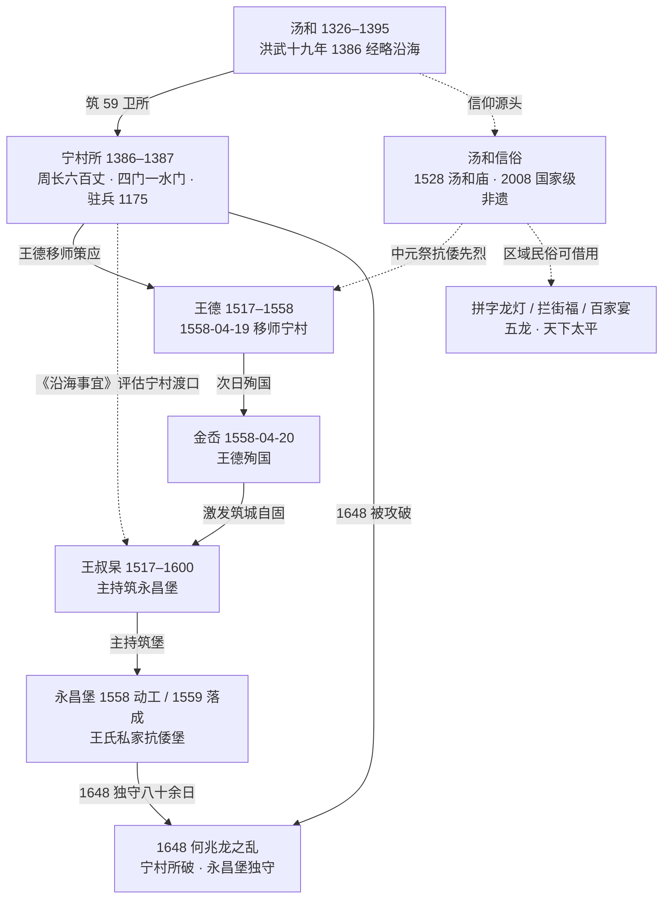

# 永昌堡 × 汤和：关系索引与可用性判断

> 索引范围：`docs/06-资料文本化/` 下 53 个文本/索引文件、44 张图片及 OCR。
> 重点语料：`文档文本/永昌堡-十三进士与抗倭纪略-全文.txt`、`文档文本/意绘抗倭英雄汤和-漫画全文.txt`、`文档文本/汤和信俗(11.18)__抵御倭患第一人+汤和(1)(1).txt`、`文档文本/汤和信俗(11.18)__汤和庙基地介绍.txt`。
> 结论先说：**能一起用，但不能说成“汤和直接建了永昌堡”。**
> 最硬的桥是 **宁村所**：汤和 1386 年筑宁村所，王德 1558 年移师宁村策应，次日金岙殉国，王氏随即筑永昌堡。

---

## 1. 语料事实：两套资料几乎是分开的

统计方式：对 `docs/06-资料文本化/` 下 53 个 `txt/md/json` 做子串计数，包含标题、页眉和 OCR 文本；数字用于判断语料分布，不等同于“独立事件数”。

| 文档 | “汤和”出现 | “永昌堡”出现 | 判断 |
|---|---:|---:|---|
| `永昌堡-十三进士与抗倭纪略-全文.txt` | 0 | 639 | 永昌堡主线，不提汤和 |
| `意绘抗倭英雄汤和-漫画全文.txt` | 106 | 0 | 汤和主线，不提永昌堡 |
| `汤和信俗(11.18)__抵御倭患第一人+汤和(1)(1).txt` | 32 | 0 | 汤和/宁村/信俗，不提永昌堡 |
| `汤和信俗(11.18)__汤和庙基地介绍.txt` | 34 | 0 | 汤和庙/宁村，不提永昌堡 |
| `汤和信俗(11.18)__龙湾汤和信俗文化节启幕在即 拼字龙灯邀您共同祈愿“天下太平”(3)(1).txt` | 7 | 0 | 2026 年 700 周年活动，不提永昌堡 |

补充：

- “汤和 + 永昌堡”在同一句中出现，只出现在 `AI资料索引与知识图谱.md:59` 的现代总结里，不是原始史料原句。
- 44 张图片全部是汤和信俗、拼字龙灯、宁村巡游、拦街福，没有永昌堡图片。视觉素材也天然分成两套。
- 因此，关系不能靠“原文互引”成立，只能靠 **人物行动、制度延续、地理相邻、后世信俗** 四类桥来建立。

---

## 2. 最硬的一条桥：王德移师宁村

这是汤和与永昌堡之间最可靠、最有戏剧性的直接连接。

1. 嘉靖三十七年（1558）四月六日，王沛、王德在梅头血战，王沛殉国。见 `永昌堡-十三进士与抗倭纪略-全文.txt:279`。
2. 四月十九日，王德为解温州府城之围，**移师靠近郡城的宁村以便策应**，与参将张鈇约定协同进军。见 `永昌堡-十三进士与抗倭纪略-全文.txt:13760`。
3. 四月二十日，王德移师宁村后，率轻兵走间道驰援，在金岙遭伏，援军背约不至，骂贼而死，年仅四十二岁。见 `永昌堡-十三进士与抗倭纪略-全文.txt:16301`。
4. 王沛、王德殉国后，王氏家族“筑城自固”的意志被彻底激发，王叔杲主持筑永昌堡。见 `永昌堡-十三进士与抗倭纪略-全文.txt:283` 和 `:288`。

这条链可以压缩成一句游戏内可显示的话：

> **洪武十九年，汤和筑宁村所。嘉靖三十七年，王德移师宁村策应，次日殉国于金岙。翌年，王氏筑永昌堡。**

这不是牵强附会：王德最后策应的城，就是汤和主持修筑的宁村所。

---

## 3. 第二条桥：王叔杲的《沿海事宜》评估过宁村

永昌堡的筑城者王叔杲，不是只守自己一堡。他写过《沿海事宜》，系统评估温州沿海三百余里防务，明确提到：

- 梅头、宁村渡口等要害；
- 宁村马道、龙湾山；
- 国初所设卫所兵力部署；
- 主张“整搠督察，无容虚冒”，不盲目增兵，强调精准布防。

见 `永昌堡-十三进士与抗倭纪略-全文.txt:15038` 和 `:15050`。

这说明：**王叔杲的筑堡思想，是在汤和留下的卫所体系上做“点状补强”。**

可用世界观表述：

> 汤和布的是“沿海长城”的线；王叔杲筑的是这条线上的一个“民堡节点”。

---

## 4. 第三条桥：1648 年的一破一守

顺治五年（1648），山寇何兆龙引海盗船千余来犯：

- 永兴堡、宁村所相继被攻破；
- 唯独永昌堡严防八十余日，“远近避乱我堡者何止万人”。

见 `永昌堡-十三进士与抗倭纪略-全文.txt:312` 和 `:15545`。

这不是 1559 年的事，不能写进正篇主线，但非常适合做 **图鉴/尾声/关卡对照**：

> 宁村所是汤和的国家卫所，永昌堡是王氏的民间私堡；一官一民，一前一后，1648 年一个被破，一个独守。

---

## 5. 制度关系：卫所 → 乡兵 → 民堡

这条是“制度类比”，不是同一句史料，但逻辑完整：

1. 汤和 1386 年经略沿海，筑 59 座卫所，推行“寓兵于民”：有事则战，无事则耕，军士就地安家。见 `汤和信俗(11.18)__抵御倭患第一人+汤和(1)(1).txt:4` 和 `:7`。
2. 宁村所 1386–1387 年建成，驻兵 1175 名，形成多姓氏军户聚落。见同文件 `:6`。
3. 嘉靖年间卫所废弛，地方自组乡兵。王沛、王德编练“王氏义师”，聚众千余人。见 `永昌堡-十三进士与抗倭纪略-全文.txt:269`。
4. 王沛、王德殉国后，流动乡兵被证明不足以自保，王氏转为筑城自固，永昌堡 1558 年动工、1559 年落成。见 `永昌堡-十三进士与抗倭纪略-全文.txt:283` 和 `:544`。

可以概括为：

> **汤和的“寓兵于民”是制度源头；王氏义师是明代中期的民间变形；永昌堡是这套传统在失败后的堡垒化。**

注意：不能写成“汤和创立了王氏义师”或“汤和指导了永昌堡筑城”，史料没有这种直接关系。

---

## 6. 信俗关系：中元祭抗倭先烈

汤和信俗的秋祭在七月十五中元节，明确是“祭祀抗倭先烈、安抚亡魂”。见 `汤和信俗(11.18)__抵御倭患第一人+汤和(1)(1).txt:17`。

巡游最后会到“埋葬倭难捐躯将士的南郊教场乱葬岗（抗倭英烈墓）”举行祭礼。见 `汤和信俗(11.18)__汤和庙基地介绍.txt:38`。

王沛、王德是嘉靖三十七年（1558）抗倭殉国的英烈。见 `永昌堡-十三进士与抗倭纪略-全文.txt:279`。

所以可以做这样的创作连接：

> 1559 年永昌堡的守灯人，在中元夜把王沛、王德的名字写进汤和信俗的英烈祭里。

但必须标注为 **游戏演绎/民俗逻辑**，不能说“宁村汤和庙史料明确祭祀王沛、王德”。现有资料只写到“抗倭先烈/倭难亡魂”这一层，没有点名二王。

---

## 7. 不能用的“假桥”：东瓯王庙

这是最容易混淆的一条，必须单独标注。

- 永昌堡书里的“东瓯王庙”祀的是 **汉东瓯王驺摇**，不是汤和。原文明确说“按王似姓名摇，汉高帝时击楚有功，王东瓯”。见 `永昌堡-十三进士与抗倭纪略-全文.txt:1517`。
- 宁村的汤和庙原名 **东瓯襄武王汤公庙**，是另一座庙。见 `汤和信俗(11.18)__汤和庙基地介绍.txt:4`。
- 汤和死后也追封“东瓯王”，所以两座“东瓯王庙”在民间叙述中容易混。做游戏时不要把永昌堡的东瓯王庙直接当成汤和庙。

结论：**“东瓯王庙”不能作为汤和与永昌堡的直接桥。**

---

## 8. 时间线：一条可显示的海防线

| 时间 | 事件 | 关系类型 | 来源 |
|---|---|---|---|
| 1326 | 汤和出生 | 人物起点 | `汤和信俗(11.18)__抵御倭患第一人+汤和(1)(1).txt:3` |
| 1369 / 1384 / 1386 / 1388 | 倭寇多次侵犯温州沿海 | 背景 | `意绘抗倭英雄汤和-漫画全文.txt:28` |
| 1386 | 汤和奉旨经略沿海，筑 59 座卫所 | 制度源头 | `意绘抗倭英雄汤和-漫画全文.txt:44` |
| 1386–1387 | 宁村所建成 | 实体桥 | `汤和信俗(11.18)__抵御倭患第一人+汤和(1)(1).txt:6` |
| 1395 | 汤和去世 | 人物终点 | `意绘抗倭英雄汤和-漫画全文.txt:1122` |
| 1528 | 宁村汤和庙始建 | 信俗载体 | `汤和信俗(11.18)__汤和庙基地介绍.txt:4` |
| 1554 / 1556 / 1558 | 倭寇再次频繁偷袭宁村 | 背景 | `意绘抗倭英雄汤和-漫画全文.txt:630` |
| 1558-04-06 | 王沛梅头殉国 | 永昌堡前史 | `永昌堡-十三进士与抗倭纪略-全文.txt:279` |
| 1558-04-19 | 王德移师宁村策应 | **最硬桥** | `永昌堡-十三进士与抗倭纪略-全文.txt:13760` |
| 1558-04-20 | 王德金岙殉国 | 永昌堡前史 | `永昌堡-十三进士与抗倭纪略-全文.txt:16301` |
| 1558–1559 | 永昌堡动工并落成 | 正篇舞台 | `永昌堡-十三进士与抗倭纪略-全文.txt:544` |
| 1648 | 宁村所破，永昌堡独守 | 后期对照 | `永昌堡-十三进士与抗倭纪略-全文.txt:312` |
| 2008 | 汤和信俗列入国家级非遗 | 活态传承 | `汤和信俗(11.18)__抵御倭患第一人+汤和(1)(1).txt:18` |
| 2026 | 汤和诞辰 700 周年 | 现实宣发 | `汤和信俗(11.18)__龙湾汤和信俗文化节启幕在即 拼字龙灯邀您共同祈愿“天下太平”(3)(1).txt:3` |

---

## 9. 关系图：实线是史料，虚线是创作



读图规则：

- **实线**：有原文事件或明确地理/人物行动支撑。
- **虚线**：制度类比、民俗逻辑、游戏创作连接，不能写成“史料原话”。
- **宁村所**是图里唯一的实体枢纽；没有它，汤和与永昌堡只能做抽象主题连接。

---

## 10. 能不能一起用：能，但要分三层

### 10.1 叙事层

推荐“三段时间”：

1. **序章：洪武十九年（1386），宁村所。**  
   操作汤和，做 3–5 分钟教学：勘察海岸、定所城、点第一盏望海灯、编练乡兵。  
   主题句：“成远算者不恤近怨，任大事者不顾细谨。”
2. **正篇：嘉靖三十八年（1559），永昌堡。**  
   操作守灯乡勇王陆/阿六。前史用王德移师宁村、金岙殉国做引子；正篇守永昌堡。  
   主题句：“你是永昌堡外最后一盏灯。”
3. **尾声：2026，汤和诞辰 700 周年。**  
   五龙拼“天下太平”，灯从 1386 传到今天。  
   主题句：“城会旧，灯不灭。”

### 10.2 系统层

| 汤和线 | 永昌堡线 | 游戏系统 |
|---|---|---|
| 望海、巡海 | 望楼灯、灯火风险 | 灯火半径/吸引敌人/摸黑刷级 |
| 寓兵于民、四丁抽一 | 王氏义师、乡兵 | 民兵成长、局外升级树 |
| 59 卫所、沿海长城 | 永昌堡、宁村所 | 双堡地图/图鉴 |
| 汤和信俗、中元祭 | 王沛/王德英烈 | 香火点、英魂祝福 |
| 拼字龙灯、天下太平 | 节庆巡游 | 五龙清屏/阵法拼字 |
| 拦街福、百家宴 | 宗族/乡邻 | 士气、回复、加速 |

### 10.3 证据层

游戏内所有文化条目建议加标签：

- `史实`：有原文直接支撑，如“王德移师宁村”“永昌堡 1559 落成”。
- `制度`：有制度/地理逻辑，如“寓兵于民→乡兵→民堡”。
- `民俗`：有活态信俗支撑，如“中元祭抗倭先烈”。
- `演绎`：游戏创作连接，如“王陆在中元夜写王沛、王德之名”。

这样既能把两条线合起来，又不会被文化评委抓住“把汤和硬塞进永昌堡”的问题。

---

## 11. 游戏内怎么“显示”这层关系

### 11.1 图鉴：双堡对照页

左右两栏，中间一条时间轴：

```text
宁村所（1386）                 永昌堡（1559）
汤和 · 国家卫所                王叔杲 · 民间私堡
59 座沿海城之一                英桥王氏自筑
寓兵于民                       乡兵失败后的堡垒化
四门一水门 · 1175 兵           四门四水门 · 敌台十二
        \                     /
         \___ 王德 1558 移师宁村 ___/
                    |
              金岙殉国 → 筑永昌
```

### 11.2 加载页/过场

一句史实，一句创作，不要混：

> 洪武十九年，汤和筑宁村所，布下沿海长城。  
> 嘉靖三十七年，王德移师宁村策应，次日殉国金岙。  
> 翌年，王氏筑永昌堡。  
> 两座城，一条海防线。

### 11.3 场景转场

- 序章宁村所：镜头从海面推向所城，汤和点灯。  
- 正篇永昌堡：同一盏灯的火焰在城头重燃，时间跳到 1559。  
- 尾声：现代宁村汤和信俗巡游，五龙拼“天下太平”，灯仍在。

### 11.4 图鉴条目写法

不要写“汤和建永昌堡”。建议写：

> **宁村所与永昌堡**  
> 汤和于洪武十九年（1386）主持修筑宁村所，属国家卫所体系。嘉靖三十七年（1558），王德移师宁村策应温州府城，次日于金岙殉国。王氏家族随后筑永昌堡。两城一官一民、一前一后，共同构成龙湾海防的“守望”链条。

---

## 12. 当前游戏实现

- 图鉴：`game/scenes/codex.tscn`、`game/scripts/ui/codex.gd`，数据源 `game/data/codex.json`。
  三栏为宁村所/汤和、王德移师宁村、永昌堡/王叔杲，下方时间轴与“不可误写”边界。
- 序章：`game/scenes/prologue.tscn`，操作汤和完成点灯、定界桩、立乡兵旗。
- 正篇：`game/scenes/run.tscn`，操作王陆/阿六守灯；王德移师宁村只作前史字幕。
- 对白与语音：`game/data/narrative.json`、`game/data/voice_lines.json`；
  每句带 `category` 与 `source_ref`，语音由 MOSS-TTS-Nano 本地生成。

---

## 12. 素材可用性

现有 `game/assets/` 以永昌堡 tiles、倭寇、乡勇、龙灯为主；没有汤和/宁村所专用素材。见 `game/assets/actors/` 和 `game/assets/tiles/yongchang/`。

需要新增或改标的原创像素素材：

- 汤和：老年将领形象，铠甲+卷册/令旗，不做少年武将。
- 宁村所：方形所城、四门一水门、护城河、练兵校场。
- 望海灯/烽火：连接 1386 与 1559 的核心道具。
- 中元祭/香亭：汤和信俗仪式层。
- 五龙：改走 `character_recipe` 的服装、背挂与主手组合生成五色变体；
  旧 `game/assets/units/longdeng/` 已删除，不再复用。

官方汤和信俗照片授权不明，按项目规则只作考据参考，不直接入包。见 `AI资料索引与知识图谱.md:19` 的授权提示。

---

## 13. 最终判断

**能一起用，最佳方式不是“汤和进永昌堡角色表”，而是“双堡结构”：**

- 汤和 = 1386 年宁村所，海防制度与精神源头，序章/信俗/英魂。
- 王德 = 1558 年宁村所的最后策应者，连接两堡的关键人物。
- 王叔杲 = 1558–1559 年永昌堡的筑城者，正篇历史锚点。
- 王陆/阿六 = 1559 年永昌堡的守灯乡勇，正篇操作主角。

一句话：

> **汤和布网，王德过桥，王叔杲筑堡，守灯人点灯。**

---

## 14. 语料索引表

| 类型 | 文件/目录 | 内容 | 在本索引中的用法 |
|---|---|---|---|
| 永昌堡主书 | `文档文本/永昌堡-十三进士与抗倭纪略-全文.txt` | 552 页；十三进士、王沛/王德、王叔杲筑堡、沿海事宜、1648 守城 | 永昌堡主线与王德移师宁村的直接证据 |
| 汤和漫画 | `文档文本/意绘抗倭英雄汤和-漫画全文.txt` | 101 页；汤和生平、1386 经略沿海、宁村所、寓兵于民 | 汤和人物线与 1386 序章素材 |
| 汤和短文 | `文档文本/汤和信俗(11.18)__抵御倭患第一人+汤和(1)(1).txt` | 汤和、宁村、汤和庙、汤和信俗、拦街福、拼字龙灯 | 汤和信俗与宁村数据的速查源 |
| 汤和庙介绍 | `文档文本/汤和信俗(11.18)__汤和庙基地介绍.txt` | 庙宇形制、碑文、张璁/戚继光诗、42 村巡游 | 中元祭、英烈墓、庙宇视觉参考 |
| 700 周年报道 | `文档文本/汤和信俗(11.18)__龙湾汤和信俗文化节启幕在即 拼字龙灯邀您共同祈愿“天下太平”(3)(1).txt` | 2026 年汤和诞辰 700 周年、五龙、158 人、25.5 米 | 尾声/宣发层 |
| 图片元数据 | `image_index.json` | 44 张图，21 巡游 + 15 照片折页 + 7 拼字龙灯 + 1 汤和像 | 素材检索与授权核对 |
| OCR | `图片OCR/` | 44 张图的 OCR 文本 | 横幅、牌匾、折页文字核对 |
| 视觉标注 | `图片视觉标注.md` | 逐图视觉描述与游戏映射 | 场景、道具、UI 参考 |
| 综合索引 | `AI资料索引与知识图谱.md` | 现代二次整理，含人物/地点/民俗图谱 | 只作导航；其中“汤和+永昌堡”同句是现代总结，不是原始史料 |

### 检索建议

```bash
rg -n "汤和|永昌堡|宁村所|王德|王叔杲|寓兵于民" docs/06-资料文本化
```

查直接关系时，先看 `永昌堡-十三进士与抗倭纪略-全文.txt` 的 `13760`、`15038`、`16301` 三处；查汤和线时，先看 `意绘抗倭英雄汤和-漫画全文.txt` 的 `44`、`630`、`706`、`1122` 四处。

